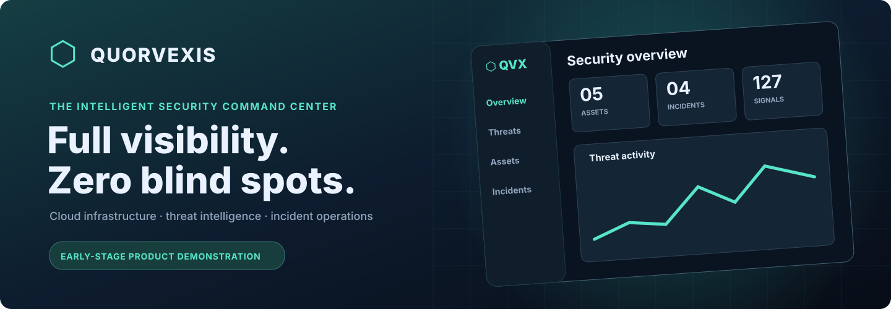
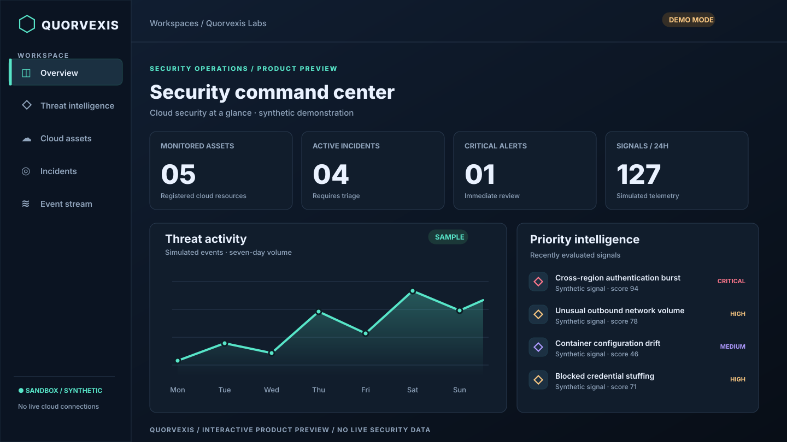
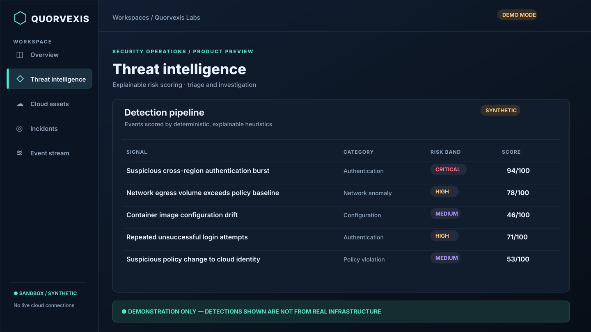
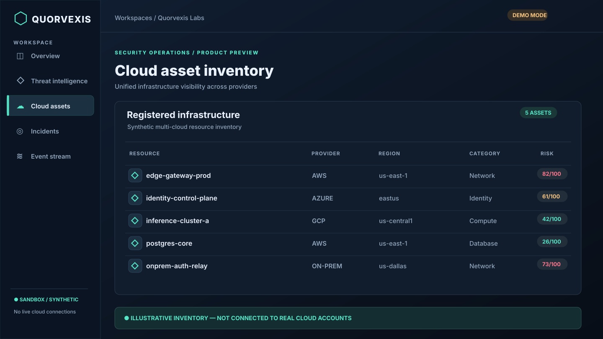

# QUORVEXIS



<p align="center"><strong>Cloud Security Intelligence · Multi-Cloud Visibility · Incident Operations</strong></p>
<p align="center">
  <a href="https://github.com/samadalam481470sa-cmd/quorvexis/actions"></a>
  
  
</p>

> **Project status:** Initial proof-of-concept with a passing configured GitHub Actions workflow. The preview images below are **illustrative renders of the synthetic demo interface**, not screenshots of a live hosted, authenticated security platform. This is not a production security product.

## Product preview

### Security command center


### Threat intelligence and cloud asset inventory

<table>
<tr>
<td width="50%"><a href="docs/images/quorvexis-threats.svg"></a></td>
<td width="50%"><a href="docs/images/quorvexis-assets.svg"></a></td>
</tr>
<tr><td><strong>Threat intelligence</strong> — categorized simulated events and explainable risk scores.</td><td><strong>Cloud inventory</strong> — an illustrative multi-provider asset view and prioritization.</td></tr>
</table>

[View the interactive demo source](apps/web/app/demo/page.tsx) · [Deployment instructions and current blocker](DEPLOYMENT.md) · [CI run history](https://github.com/samadalam481470sa-cmd/quorvexis/actions)

---

## How this project works

Quorvexis is an **early-stage enterprise security operations prototype** combining a Next.js command center, a FastAPI service, PostgreSQL organization-scoped models, MongoDB telemetry, Redis-backed rate limiting, deterministic explainable risk scoring, and a Docker Compose development environment.

The `/demo` route is designed for a no-login, synthetic-data walkthrough. The authenticated workspace needs the backend and databases. Public hosting remains separate from local execution.

## ⚠️ Run and deployment status

- **Continuous integration:** the last checked GitHub workflow passed on October 29, 2026; subsequent changes should be checked in [Actions](https://github.com/samadalam481470sa-cmd/quorvexis/actions).
- **Local execution:** Docker Compose and `.env` setup are required; a fully integrated runtime test has not been performed.
- **Public demo:** Vercel's GitHub auto-deploy integration previously blocked the repository connection; see [DEPLOYMENT.md](DEPLOYMENT.md). Do not assume a hosted URL exists until one is linked and verified.
- **Not yet implemented:** production auth/MFA/SSO, real integrations, a trained ML threat detector, billing, hardened cloud deployments.

## Features implemented

- Responsive dark-mode command center, organization registration and sign-in.
- Next.js server-side API gateway; HttpOnly SameSite=Strict session cookie. The JWT stays server-side rather than being stored in browser localStorage.
- FastAPI with access tokens (15-minute expiry), Argon2id passwords, bounded registration/login attempts, allowlisted proxy routes, input validation and baseline security headers.
- PostgreSQL for users, organizations, memberships, assets, incident records, and audit entries. All read/write queries scope by the principal's organization.
- MongoDB for time-series signal ingestion and 7-day dashboards, with indexed organization and timestamp.
- Redis for IP/account-scoped rate limits. Explainer-based event risk scoring with no opaque AI claims.
- Role-gated asset creation, incident creation/updates and event ingestion. Production mode disables demo seed route.
- Docker Compose for four internal services, automated Python tests, web type checking/build and CI.

## Local start

Requirements: Docker and Docker Compose.

1. Copy `.env.example` to `.env`.
2. Generate a unique JWT secret using `python -c "import secrets; print(secrets.token_urlsafe(48))"` and set `JWT_SECRET`.
3. Set `POSTGRES_PASSWORD` to a long URL-safe password. Keep `.env` out of Git.
4. Run `docker compose up --build`.
5. Open **http://localhost:3000**. Create a workspace with a strong password. If `DEMO_MODE=true`, the owner can load clearly labeled synthetic data.

The only port exposed is the local web UI on **127.0.0.1:3000**; databases and API remain on Docker's internal network.

## Architecture

```text
Browser (session cookie)
    |
Next.js frontend and same-origin BFF [apps/web]
    | Authorization: Bearer token (internal)
FastAPI [apps/api]
    |-- PostgreSQL: organizations, users, roles, assets, incidents, audit trail
    |-- MongoDB: indexed security signal records and trending
    |-- Redis: distributed login/registration rate limiting
```

API routes (via web gateway): `/me`, `/overview`, `/assets`, `/incidents`, `/incidents/:id`, `/signals`, and the optional `/demo/seed`. OpenAPI is available at `http://api:8000/docs` from within the private network in development.

## Access control

Viewer: read only. Analyst: read + event/asset/incident writes. Admin: analyst privileges. Owner: admin privileges + optional development-only seed. Authorization is enforced server-side; browser UI permissions are not a trust boundary. Organization identity is taken from the signed token and revalidated against memberships on every API request, not accepted as a user-supplied organization ID.

## Engineering limitations and production roadmap

This first release is a functional skeleton rather than a production deployment. Before commercial rollout: implement password-reset and email-verification flows, verified domains and invitations, passkeys/MFA, OIDC/SAML SSO, session rotation and revocation, managed TLS ingress and WAF, trusted proxy configuration, Alembic migrations, database encryption/authentication and private network segmentation, secrets manager, telemetry retention/TTL, OpenTelemetry, backup restoration tests, SIEM ingestion connectors, multi-tenant integration tests, reliable event queues, SBOM/dependency scanning, security audit, legal/privacy review, billing, and SLOs. The development Compose databases have no internal authentication and **must not be exposed to public networks**.

The risk engine is rules-based and explainable, not a trained machine-learning system. Analytics reflect user-provided or synthetic signals, not a live security feed.

## Testing

```bash
python -m pip install -r apps/api/requirements.txt
PYTHONPATH=apps/api JWT_SECRET=testing-only-secret-not-for-production-use pytest apps/api/tests
cd apps/web && npm install && npm run lint && npm run build
```

## License

MIT; see [LICENSE](LICENSE).
